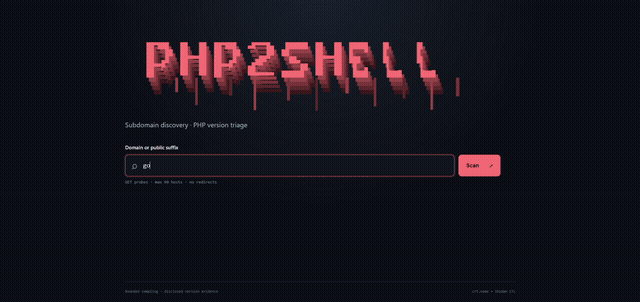

# PHP2Shell Exposure Check

[](https://github.com/renegadecrew/php2shell/actions/workflows/ci.yml)
[](LICENSE)


Open-source blue-team PHP2Shell exposure triage. Discover hostnames from certificate-transparency data and assess HTTP evidence for vulnerable PHP runtimes.

It reports **affected candidates** when disclosed version evidence is below a fixed release. For the exact registrable domain, it also checks exposed `phpinfo()` output for the PHP2Shell fix marker. A complete Core table without that marker plus an affected version is strong exposure evidence; a version alone remains a candidate because vendor backports can change the result. Hidden versions and server-side configuration can still make remote results inconclusive. The fix-marker method follows the non-invasive approach documented by [PHP2Shell-Check](https://github.com/covertswarmlabs/PHP2Shell-Check).

## Demo

[](assets/php2shell-demo.mp4)

The preview plays inline. Click it to open the full MP4 demo.

## Requirements

- Node.js 20 or later
- npm

## Run locally

```sh
npm install
npm start
```

Open <http://127.0.0.1:3000>. Set `PORT` to change the port. The server binds to `127.0.0.1` by default.

## CLI

Run directly via the portable launchers (matching `shodan_reconsx` conventions) or `npm run cli`:

Linux / macOS / Termux:

```sh
chmod +x scan.sh
./scan.sh example.com
```

Windows PowerShell:

```powershell
.\scan.ps1 example.com
```

Options:

```sh
./scan.sh --input domains.txt --format json --output results.json
./scan.sh example.com --passive --format txt
./scan.sh example.com --all-batches --max-batches 5 --no-color
```

- The ASCII `PHP2SHELL` banner and progress status are written to `stderr` (in bright red when `stderr` is an interactive TTY), keeping `stdout` clean for pipes and redirection.
- `--no-color` and the standard `NO_COLOR` environment variable disable ANSI colors (`NO_COLOR` overrides `--color`). `--help` and `--version` omit the banner.
- `--input <file>` reads one domain or public suffix per line, ignoring blank lines and `#` comments and deduplicating entries.
- Set `PHP2SHELL_NODE` to choose a specific `node` binary in `scan.sh` or `scan.ps1`.

## Discovery and live checks

- Accepts registrable domains with recognized ICANN TLDs such as `example.com` and `site.com.mx`, and public suffixes such as `gob.mx` and `.mx`.
- Registrable domains are discovered through **Shodan CTL** and **crt.name**. Public suffixes use **Shodan CTL** and **crt.sh**. A working source can still return results when another source fails; source errors are included in the response.
- Shodan CTL hostnames are selected first for live checks. For registrable domains, the queried domain is also included in the first batch; remaining slots use CTL hosts before fallback sources.
- Live checks run by default. Each scan selects up to 30 unique hosts per batch and checks at most 90 random hosts by default. A host is removed from the pool once selected, so it is never probed twice. The UI can continue beyond 90 hosts with its explicit slower-scan option; the CLI can use `--all-batches` or set another limit with `--max-batches <n>`.
- Checks use `GET` requests over HTTPS, falling back to HTTP if the HTTPS root request fails (and recording the TLS failure reason in probe evidence). The exact registrable domain also checks `/phpinfo.php` and `/info.php` for the fix marker; other hosts use version fingerprinting and PHP presence signals.
- Requests do not follow redirects (while recording `Location` headers on 3xx responses) and have a 4-second timeout. Responses are capped at 8 KB, except the two exact-domain `phpinfo()` checks, capped at 256 KB. DNS results that include non-public addresses are skipped.
- The exact-domain result separates a detected patch marker, a version-based affected candidate, and an inconclusive result. The scanner does not send exploit or behavioral probes; a hidden runtime requires host-side verification.
- The main table contains only affected candidates. Per-host probe evidence includes response status, protocol, checked paths, redirect targets, TLS fallback errors, PHP signals, version source, and assessment, with search and status filters plus JSON and CSV exports.
- CT source responses are cached in process memory for 30 minutes (up to 64 entries). Live HTTP checks are performed on every scan.

The server binds to `127.0.0.1` by default. API requests must use a loopback `Host` and, when present, a matching same-origin `Origin`; this helps prevent other websites from triggering scans through a local browser. The existing rate limit and public-address checks also apply. No token or domain allowlist is required, and the API does not verify domain ownership. Only scan systems you are authorized to assess. Do not expose the service beyond localhost without adding a suitable network access control.

## API

### Async streaming scans (`POST /api/scans`)

Starts a background scan and returns `202` with `{ "scanId": "<uuid>" }`.

Request body:

```json
{
  "domain": "example.com",
  "activeCheck": true,
  "stopOnCandidate": true,
  "maxBatches": 3
}
```

- `GET /api/scans/<scanId>/events`: Server-Sent Events (`progress`, `batch`, `complete`, `cancelled`, `scan-error`) delivering incremental results after every 30-host batch.
- `POST /api/scans/<scanId>/cancel`: Aborts an active scan while retaining partial results from already-checked hosts.
- `GET /api/scans/<scanId>`: Returns the current scan snapshot (`status`, `progress`, `report`, `error`).

### Synchronous lookup (`POST /api/lookup`)

Request body:

```json
{
  "domain": "example.com",
  "activeCheck": true,
  "scanId": "optional-uuid"
}
```

`activeCheck` defaults to `true`. Active checks use up to three randomized 30-host batches (90 unique hosts total) unless `maxBatches` is set. Use `maxBatches: null` to check every discovered host. Set `activeCheck` to `false` for passive discovery without contacting discovered hosts. When `scanId` is provided, progress is available at `GET /api/progress?id=<scanId>`.

The response includes:

- `findings`: affected candidates during live checks, or a discovery sample in passive public-suffix mode
- `checks`: per-host live-check results and evidence
- `stats`: discovery and probe counts
- `errors`: unavailable CT sources, if any
- `cves`: advisory references

Other endpoint: `GET /api/health`.

## Fixed releases

The current fixed releases used by the classifier are:

| PHP branch | Fixed release |
| --- | --- |
| 8.2 | 8.2.35 |
| 8.3 | 8.3.36 |
| 8.4 | 8.4.27 |
| 8.5 | 8.5.12 |

Older branches are treated as candidates with vendor backport status unknown. Verify the installed package with its vendor. See the [PHP security advisory](https://www.php.net/archive/2026.php#2026-10-21-5), [CVE-2026-109618](https://www.cve.org/CVERecord?id=CVE-2026-109618), and [CVE-2026-109619](https://www.cve.org/CVERecord?id=CVE-2026-109619).

## Tests

```sh
npm test
```

The test suite covers domain normalization, CT parsing, PHP version classification, HTTP 200/403 handling, CT caching, batch limits, candidate filtering, and rejection of non-public IP addresses. GitHub Actions runs it on Node.js 20, 22, and 24 for pushes and pull requests.

## Contributing

See [CONTRIBUTING.md](CONTRIBUTING.md), the [Code of Conduct](CODE_OF_CONDUCT.md), [Support](SUPPORT.md), and the [Security Policy](SECURITY.md). Dependabot checks npm packages and GitHub Actions weekly.

## License

This project is licensed under the [MIT License](LICENSE). The adapted banner artwork is derived from DevCop95's MIT-licensed [Shodan ReconsX artwork](https://github.com/DevCop95/shodan_reconsx); see [THIRD_PARTY_NOTICES.md](THIRD_PARTY_NOTICES.md).
