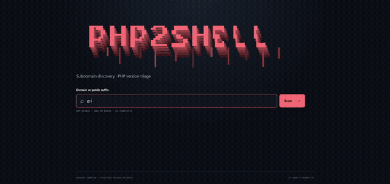

# PHP2Shell Exposure Check

[](https://github.com/DevCop95/php2shell/actions/workflows/ci.yml)
[](LICENSE)


Open-source blue-team PHP2Shell exposure triage. Discover hostnames from certificate-transparency data and check HTTP responses for disclosed PHP versions below fixed releases.

It reports **affected candidates** when a disclosed PHP version is below the fixed release for its branch or belongs to a legacy branch. A banner alone cannot confirm exploitability; vendor backports and hidden or spoofed versions require host-side verification.

## Demo

[](assets/php2shell-demo.mp4)

The preview plays inline. Click it to open the full MP4 demo.

## Requirements

- Node.js 20 or later
- npm

## Run locally

```sh
npm install
npm start
```

Open <http://127.0.0.1:3000>. Set `PORT` to change the port. The server binds to `127.0.0.1` by default.

## Discovery and live checks

- Accepts registrable domains such as `example.com` and `site.com.mx`, and public suffixes such as `gob.mx` and `.mx`.
- Registrable domains are discovered through **Shodan CTL** and **crt.name**. Public suffixes use **Shodan CTL** and **crt.sh**. A working source can still return results when another source fails; source errors are included in the response.
- Shodan CTL hostnames are selected first for live checks. For registrable domains, the queried domain is also included in the first batch; remaining slots use CTL hosts before fallback sources.
- Live checks run by default. Each scan selects up to 30 unique hosts per batch, for at most three batches (90 hosts total), and stops after the first batch with affected candidates.
- Checks use `GET` requests over HTTPS, falling back to HTTP if the HTTPS root request fails. The scanner checks `/` and, if no PHP version is disclosed, a random `.php` path, `/phpinfo.php`, and `/info.php` until a version is found.
- Requests do not follow redirects, have a 4-second timeout, and read at most 8 KB per response. DNS results that include non-public addresses are skipped.
- The main table contains only affected candidates. Per-host probe evidence includes response status, protocol, checked paths, PHP signals, version source, and assessment. JSON and CSV exports are available.
- CT source responses are cached in process memory for 30 minutes (up to 64 entries). Live HTTP checks are performed on every scan.

The server binds to `127.0.0.1` by default. API requests must use a loopback `Host` and, when present, a matching same-origin `Origin`; this helps prevent other websites from triggering scans through a local browser. The existing rate limit and public-address checks also apply. No token or domain allowlist is required, and the API does not verify domain ownership. Only scan systems you are authorized to assess. Do not expose the service beyond localhost without adding a suitable network access control.

## API

### `POST /api/lookup`

Request body:

```json
{
  "domain": "example.com",
  "activeCheck": true,
  "scanId": "optional-uuid"
}
```

`activeCheck` defaults to `true`. Set it to `false` for passive discovery without contacting discovered hosts. When `scanId` is provided, progress is available at `GET /api/progress?id=<scanId>`.

The response includes:

- `findings`: affected candidates during live checks, or a discovery sample in passive public-suffix mode
- `checks`: per-host live-check results and evidence
- `stats`: discovery and probe counts
- `errors`: unavailable CT sources, if any
- `cves`: advisory references

Other endpoint: `GET /api/health`.

## Fixed releases

The current fixed releases used by the classifier are:

| PHP branch | Fixed release |
| --- | --- |
| 8.2 | 8.2.35 |
| 8.3 | 8.3.36 |
| 8.4 | 8.4.27 |
| 8.5 | 8.5.12 |

Older branches are treated as candidates with vendor backport status unknown. Verify the installed package with its vendor. See the [PHP security advisory](https://www.php.net/archive/2026.php#2026-10-21-5), [CVE-2026-109618](https://www.cve.org/CVERecord?id=CVE-2026-109618), and [CVE-2026-109619](https://www.cve.org/CVERecord?id=CVE-2026-109619).

## Tests

```sh
npm test
```

The test suite covers domain normalization, CT parsing, PHP version classification, HTTP 200/403 handling, CT caching, batch limits, candidate filtering, and rejection of non-public IP addresses. GitHub Actions runs it on Node.js 20, 22, and 24 for pushes and pull requests.

## License

This project is licensed under the [MIT License](LICENSE). The adapted banner artwork is derived from DevCop95's MIT-licensed [Shodan ReconsX artwork](https://github.com/DevCop95/shodan_reconsx); see [THIRD_PARTY_NOTICES.md](THIRD_PARTY_NOTICES.md).
